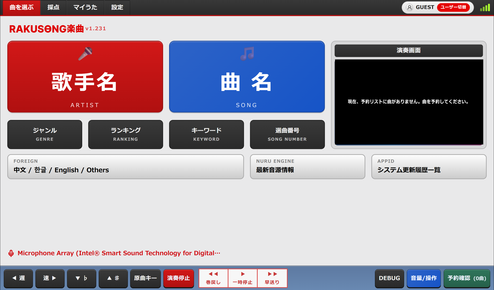
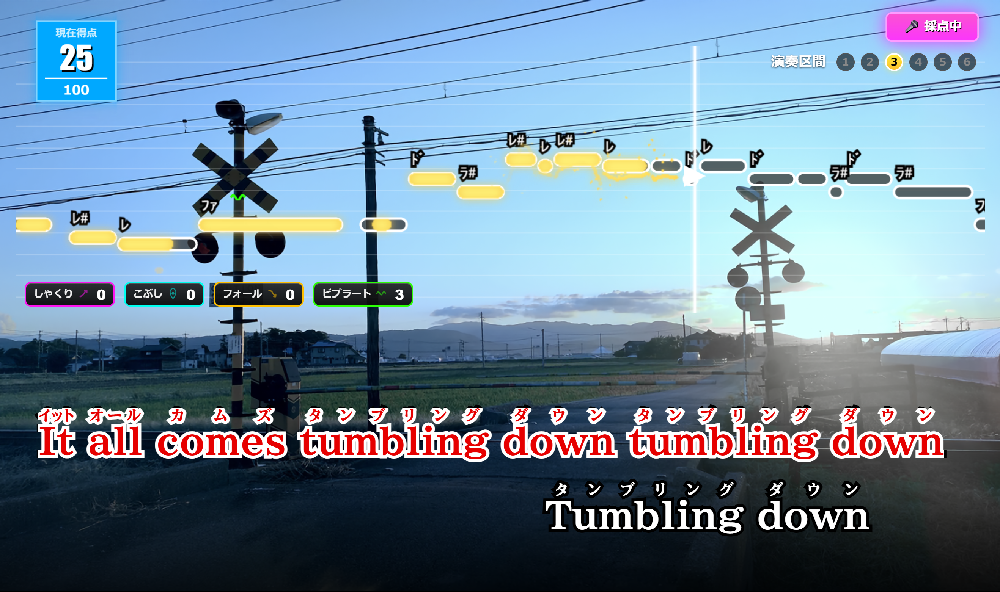

# Raku Sound

**Japanese Style Online Karaoke System**

Raku Sound 是一个日式风格的在线卡拉 OK 系统，将点歌、MIDI 伴奏、同步歌词和实时演唱评分带到浏览器中。项目以日式卡拉 OK 的操作与演唱界面为灵感，结合音高导引、演唱技巧反馈和动态背景，让你在电脑上也能享受唱歌与练习的乐趣。

## 界面预览

### 点歌首页

按歌手、曲名、关键词和选曲编号查找歌曲，管理歌曲预约，并调整播放速度、音调和音量。



### 演唱与实时评分

同步歌词与注音、旋律音高导引、当前得分，以及しゃくり、こぶし、フォール和ビブラート等演唱技巧反馈。



## 主要功能

- **日式点歌体验**：歌曲与歌手搜索、分类筛选、歌曲预约和播放控制。
- **浏览器 MIDI 伴奏**：使用 SpessaSynth 与 SoundFont 合成音源，配合 MIDI 标准识别及音色映射。
- **同步歌词**：解析 LRC 歌词，支持注音显示与演唱进度高亮。
- **实时音高与评分**：通过麦克风检测音高，与参考旋律对照，并在演唱结束后展示结果。
- **演唱技巧分析**：识别颤音、こぶし、上滑音和下滑音，提供可视化反馈。
- **个性化设置**：音调与速度调整、麦克风选择与延迟校准，以及音源和音频效果设置。
- **账号与成绩**：用户注册与登录、收藏歌曲、成绩记录和歌曲排行榜。
- **曲库管理**：Django 后台管理歌曲、歌手、标签，以及 MIDI 和歌词文件。

## 技术栈

| 部分 | 技术 |
| --- | --- |
| 前端 | React、Vite、Zustand、Bootstrap |
| 图形与演唱界面 | PixiJS、Canvas |
| 伴奏与音频 | SpessaSynth、SoundFont、Web Audio API |
| 音高与演唱分析 | Pitchy、Aubio、TensorFlow.js 等音高检测方案 |
| 后端 | Django、Django REST Framework、JWT |
| 数据存储 | SQLite（默认） |

## 本地运行

需要安装 Node.js（满足 Vite 7 的要求：20.19+ 或 22.12+）和兼容 Django 5 的 Python 环境。下面以 Windows PowerShell 为例。

### 1. 启动后端

在项目根目录运行：

```powershell
cd backend
python -m venv .venv
.\.venv\Scripts\python.exe -m pip install -r requirements.txt
.\.venv\Scripts\python.exe manage.py migrate
.\.venv\Scripts\python.exe manage.py createsuperuser
.\.venv\Scripts\python.exe manage.py runserver 8000
```

管理后台：<http://localhost:8000/admin/>。使用创建的管理员账号登录，添加或维护曲库中的歌曲、MIDI 与歌词文件。

### 2. 启动前端

打开另一个终端，在项目根目录运行：

```powershell
cd frontend
npm install
npm run dev
```

打开终端显示的地址，默认是 <http://localhost:5173>。开发环境默认连接 <http://localhost:8000> 的后端。

如需连接其他后端，在 `frontend/.env.local` 中设置：

```dotenv
VITE_API_BASE_URL=http://localhost:8000
```

修改后重新启动前端开发服务器。生产构建也通过此变量配置 API 地址；未设置时，当前代码使用 `https://raku-sound.okamei.net`。

### 3. 开始演唱

允许浏览器访问麦克风，选择歌曲并加入预约列表，然后开始播放。可在设置中选择麦克风、校准延迟并调整音源。麦克风访问需要 HTTPS 或 localhost 环境。

### 构建前端

```powershell
cd frontend
npm run build
```

构建产物位于 `frontend/dist/`。后端配置与 API 说明见 [backend/README.md](backend/README.md)。

## 项目结构

```text
frontend/       React 前端、演唱界面与浏览器音频引擎
backend/        Django API、曲库管理、用户与成绩服务
docs/           README 使用的项目截图
doc/            其他项目文档
```
